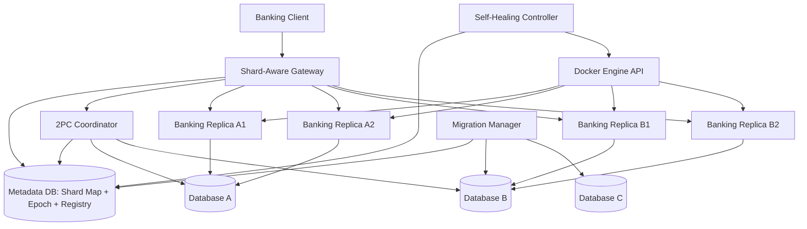

# طراحی فنی اولیه — Distributed Banking Platform

> نسخه 0.1 | مرحله 00 | شامل تمام الزامات پایه، Bonus I و Bonus II  
> مبنا: Assignment2_Distributed_Banking_Platform.pdf (چهار صفحه)

## 1. تصمیم‌های فناوری

- Python + FastAPI برای Gateway، Banking Server، Coordinator، Migration Manager و Self-Healing Controller
- PostgreSQL برای پایگاه داده‌های Shard A / Shard B / Shard C و Metadata
- Docker Compose برای اجرای سرویس‌ها روی یک Host (ویندوز با Docker Desktop)
- Pytest و HTTPX برای آزمون‌ها
- REST/HTTP درون شبکه خصوصی Compose
- اعداد پول: `NUMERIC(20,2)` و `Decimal`؛ هرگز `float`

## 2. اصول غیرقابل نقض (Invariants)

1. هر Account دقیقاً یک نویسنده معتبر (authoritative owner) در هر لحظه دارد.
2. Shard A حساب‌های `A0001` تا `A1000` و Shard B حساب‌های `A1001` تا `A2000` را در ابتدا نگهداری می‌کنند.
3. هر Shard حداقل دو Replica بانکی دارد، اما Replicaها موجودی مستقل نگهداری نمی‌کنند.
4. عملیات هم‌زمان موجب Lost Update، موجودی منفی ناخواسته یا خلق/حذف پول نمی‌شوند.
5. انتقال درون Shard در یک تراکنش محلی انجام می‌شود.
6. انتقال بین Shardها با 2PC واقعی اجرا می‌شود، نه دو آپدیت متوالی.
7. تصمیم پایدار `COMMIT_DECIDED` هرگز با `ABORT` جایگزین نمی‌شود.
8. نتیجه موفق تنها پس از تایید Commit همه مشارکت‌کنندگان گزارش می‌شود؛ وضعیت نامعلوم از طریق `transaction_id` قابل پرس‌وجو است.
9. هر درخواست انتقال یک `client_request_id` یکتا دارد؛ Retry نباید دوباره اثر مالی ایجاد کند.
10. در Re-Sharding نوشتن روی Shard قبلی پیش از فعال‌شدن Shard جدید Fence می‌شود؛ بررسی Epoch در خود Shard و درون تراکنش نوشتن است.
11. وقایع تغییر موجودی برای Migration به‌شکل پایدار، تراکنشی، قابل بازپخش و دارای نسخه/ترتیب ذخیره می‌شوند.
12. Self-Healing از ابزارهای آماده Orchestrator و Docker auto-restart استفاده نمی‌کند.

## 3. معماری منطقی



ارتباط Coordinator با Shardها از طریق endpoint های اختصاصی شرکت‌کنندگان صورت می‌گیرد. فلش مستقیم به DB در دیاگرام صرفاً نشان‌دهنده تراکنش هماهنگ‌شده است، نه دورزدن Replicaها توسط کلاینت.

## 4. سرویس‌ها و دامنه مسئولیت

| سرویس | مسئولیت | ماندگاری داده |
|---|---|---|
| Client | Balance/Deposit/Withdraw/Transfer/Status با Request ID | خیر |
| Gateway | پیدا کردن مالک با Epoch؛ Load Balancing فقط در همان Shard؛ انتخاب Replica سالم | Cache قابل بازسازی |
| Banking Replica | API عملیات، قفل‌گذاری، کنترل Epoch، 2PC participant | حساب‌ها در DB همان Shard |
| Coordinator | تولید tx_id، prepare، تصمیم پایدار، commit/abort و recovery | Metadata DB |
| Migration Manager | Snapshot، capture/replay، checkpoint، Fence، Cutover و recovery | Metadata DB + DBهای Shard |
| Self-Healing Controller | Desired replicas، کشف سلامت، reconcile با وضعیت واقعی Docker، جایگزینی | Metadata DB + Docker labels |
| Metadata DB | نسخه Map، مالکیت، رجیستری، رکورد Coordinator، مراحل Migration | Volume پایدار |

Shard C در شروع غیرفعال است و در زمان Migration به‌صورت پویا با DB و حداقل دو Replica ایجاد خواهد شد.

## 5. مدل‌های داده پیشنهادی

### در هر Shard DB

- `accounts(account_id PK, balance NUMERIC(20,2), version BIGINT, ...)`
- `account_changes(account_id, version, transaction_id, new_balance, ...; UNIQUE(account_id,version))`: ژورنال پایدار تغییرات هم‌تراکنش با به‌روزرسانی حساب
- `request_dedup(client_request_id PK, tx_id, state, result...)`: فقط با سازگاری تراکنشی مناسب
- `ownership_fence(account_range, epoch, writable, ...)`: بررسی در مسیر نوشتن خود Shard
- Prepared transactions که PostgreSQL در `pg_prepared_xacts` قابل مشاهده می‌کند

### در Metadata DB

- `shard_map(range_start, range_end, owner_shard, epoch, ...)`
- `replica_registry(shard_id, slot, container_id, endpoint, health, ...)`
- `transactions(tx_id PK, client_request_id UNIQUE, participants, state, decision, ...)`
- `transaction_participants(tx_id, shard_id, prepare_gid, prepare_ack, completion_ack, ...)`
- `migration_jobs(job_id, source, target, ranges, phase, checkpoint, epoch_before, epoch_after, ...)`
- `migration_checkpoints(job_id, account_id / position, applied_version, ...)`

اسکیماها نسخه اولیه طراحی‌اند؛ جزئیات constraints و معاملات اتمیک در مرحله 02 نهایی می‌شوند.

## 6. API قرارداد اولیه

| Method | Endpoint | مسئول |
|---|---|---|
| GET | `/health` | همه سرویس‌ها |
| GET | `/accounts/{account_id}/balance` | Gateway -> Banking |
| POST | `/accounts/{account_id}/deposit` | Gateway -> Banking |
| POST | `/accounts/{account_id}/withdraw` | Gateway -> Banking |
| POST | `/transfers` | Gateway -> محلی یا Coordinator |
| GET | `/transactions/{tx_id}` | Gateway -> Coordinator |
| POST | `/internal/2pc/prepare` | Coordinator -> Banking |
| POST | `/internal/2pc/commit` | Coordinator -> Banking |
| POST | `/internal/2pc/abort` | Coordinator -> Banking |
| GET | `/internal/replica/health` | Gateway/Controller -> Banking |
| POST | `/admin/migrations` | Migration Manager (فقط مدیریت داخلی) |
| GET | `/admin/migrations/{job_id}` | Migration Manager |

برای درخواست‌های تغییردهنده از `client_request_id` و برای مسیریابی از `shard_epoch` استفاده می‌کنیم. Endpoint های داخلی در شبکه خصوصی Compose و با محدودسازی دسترسی قرار می‌گیرند.

## 7. ماشین حالت Coordinator و 2PC

```text
INITIATED -> PREPARING -> PREPARED -> COMMIT_DECIDED -> COMPLETED
                        \-> ABORT_DECIDED -> COMPLETED
             \----------> ABORT_DECIDED -> COMPLETED
```

- Coordinator ابتدا `tx_id`، Request ID و شرکت‌کنندگان را در دیتابیس پایدار ثبت می‌کند.
- هر Participant در تراکنش PostgreSQL، اعتبارسنجی و قفل‌گذاری و تغییرات مربوط به خودش را انجام می‌دهد، سپس `PREPARE TRANSACTION` را اجرا می‌کند.
- Coordinator فقط پس از YES همه شرکت‌کنندگان، `COMMIT_DECIDED` را **پایدار** می‌کند و سپس `COMMIT PREPARED` می‌فرستد.
- اگر هر Participant رد کرد، `ABORT_DECIDED` پایدار می‌شود و تمامی Participantهای آماده‌شده `ROLLBACK PREPARED` دریافت می‌کنند.
- پیام تکراری باید ایمن باشد؛ اگر پاسخ COMMIT گم شود، وضعیت واقعی Participant بررسی می‌شود و Coordinator عمل را با همان tx_id ادامه می‌دهد.
- قطعی پس از تصمیم COMMIT وضعیت را معکوس نمی‌کند. تا زمان Ack همه Participantها نتیجه `PENDING`/`UNKNOWN` در API قابل مشاهده است، نه موفقیت قطعی.
- `max_prepared_transactions` باید برای PostgreSQL غیرصفر و متناسب با بار تنظیم شود؛ Preparedهای بلاتکلیف باید در Recovery پیگیری شوند.

## 8. معماری مهاجرت زنده (Bonus I — الزامی)

محدوده: انتقال `A1501` تا `A2000` از Shard B به C، در حین سرویس‌دهی به درخواست‌های هم‌زمان.

ماشین حالت پایدار پیشنهادی:

```text
PLANNED -> TARGET_READY -> SNAPSHOTTING -> CATCHING_UP
        -> FENCING -> FINAL_REPLAY -> MAP_ACTIVATED -> VERIFYING -> COMPLETED
```

- **Target ready:** ساخت DB و Replicaهای C؛ هنوز مالک حساب‌های مهاجرتی نیستند.
- **Consistent snapshot:** خواندن داده‌های B با snapshot سازگار PostgreSQL؛ تغییرات هم‌زمان از دست نمی‌روند.
- **Change capture:** ثبت تراکنشی تغییرات حساب‌ها در جدول پایدار با `(account_id,version)`؛ نسخه برای هر حساب زیر قفل ردیف افزایش می‌یابد. Replay هر حساب به ترتیب Version و به‌صورت idempotent انجام می‌شود؛ حالت تراکنش‌های چندحسابی نیز در ارزیابی سازگاری لحاظ می‌شود.
- **Catch-up:** در حین bulk copy کاربران همچنان روی B عملیات دارند. Checkpointها در Metadata DB پایدار می‌مانند؛ تکرار پس از Crash مجاز و بی‌اثر است.
- **Fence:** ابتدا ورود تراکنش جدید روی حساب‌های مهاجرتی B ممنوع می‌شود؛ تمام تراکنش‌های Prepared درگیر تعیین تکلیف یا به‌طور ایمن مسدود می‌شوند.
- **Final replay:** پس از اطمینان از نبود نوشتن و تراکنش Prepared بلاتکلیف، همه Deltaهای نهایی اعمال و صحت داده‌ها تأیید می‌شود.
- **Atomic ownership:** تصمیم Cutover پایدار، Epoch یکنواخت افزایش می‌یابد، سپس C فعال می‌شود. ترتیب طراحی تضمین می‌کند B و C هرگز هم‌زمان Writable نباشند؛ توقف کوتاه در Cutover مجاز است.
- **Stale route fencing:** درخواست با Epoch قدیمی در سطح DB Shard قدیمی رد می‌شود؛ صرفاً Gateway کافی نیست.
- **Cleanup:** داده‌های قدیمی فقط پس از تأیید کامل عملیات پاک‌سازی می‌شوند.
- **Recovery:** در Snapshot، Replay، Fencing و پس از Map Activation پیش از Cleanup با Crash عمدی تست می‌شود.

**ملاحظه فنی:** برای مکانیزم نسخه‌بندی/ژورنال و اتمیک بودن Replay تراکنش‌های چندحسابی، قبل از پیاده‌سازی نهایی باید یک آزمایش صحت ترتیب commit و تحویل event طراحی شود؛ از شمارنده عمومی `BIGSERIAL` به‌تنهایی به‌عنوان ترتیب commit استفاده نخواهیم کرد.

## 9. معماری Self-Healing (Bonus II — الزامی)

- `desired_replicas_per_shard >= 2` در Metadata DB پایدار است.
- Controller در حلقه reconcile ابتدا Docker Engine را بر اساس Labelهای مدیریت‌شده و شیارهای یکتای `shard + replica_slot` بررسی می‌کند.
- اگر Replica خراب بود، آن را از فهرست قابل انتخاب Gateway خارج و به‌صورت کنترل‌شده یک Replacement ایجاد می‌کند.
- برای جلوگیری از Duplicate پس از Crash، نام/Label تعیین‌کننده شیار، استعلام وضعیت واقعی Docker و عملیات idempotent استفاده می‌شود.
- `restart: always`, `on-failure`, Docker Swarm و Kubernetes برای Self-Healing استفاده نمی‌شوند.
- خود Controller ممکن است برای دمو به‌صورت دستی دوباره Start شود؛ پس از بازگشت باید Reconcile صحیح و بدون Replica تکراری داشته باشد.
- ارتباط Controller با Docker daemon دارای سطح دسترسی بالاست؛ صرفاً در محیط توسعه محلی و با دسترسی کنترل‌شده استفاده می‌شود، نه اتصال عمومی بدون حفاظت.

## 10. نقشه آزمون‌های قبولی

### هفت آزمایش اجباری صورت پروژه

1. Shard distribution — داده‌های حساب فقط در DB مالک باشند.
2. Replica load distribution — توزیع درخواست و لاگ Replicaها.
3. Concurrent replica operations — عدم Lost Update.
4. Replica interruption — ادامه خدمت با Replica سالم.
5. Local/cross-shard transfers — صحت تراکنش محلی و 2PC.
6. Interrupted distributed transaction — بعد از Durable COMMIT و قبل از تمام Ackها Coordinator قطع و بازیابی شود.
7. Concurrent cross-shard transfers — عملیات حساب‌های مشترک و قانون بقای مجموع پول.

### آزمون‌های Bonus I

- مهاجرت در بار هم‌زمان و Catch-up صحیح؛
- اثبات نوشته‌نشدن در B با Epoch قدیمی پس از Cutover؛
- ادامه یا توقف ایمن تراکنش‌های 2PC در جریان مهاجرت، Request ID و Retry امن؛
- Crash در چهار نقطه Snapshot، Delta Replay، Fencing و بعد از Map Activation؛
- عدم پاک‌سازی پیش از Verification و عدم دو مالک Writable.

### آزمون‌های Bonus II

- قطع Replica تحت بار، ایجاد خودکار کانتینر جایگزین بدون اختلال در Replica سالم؛
- قطع و راه‌اندازی Controller وسط Replacement بدون ایجاد Duplicate؛
- کنترل صحت تراکنش‌های بانکی در طول خرابی و بازیابی.

## 11. ساختار پیشنهادی مخزن

```text
distributed-banking-platform/
├── README.md
├── compose.yaml
├── .env.example
├── docs/
│   ├── architecture.md
│   ├── 2pc-sequence.md
│   ├── migration-protocol.md
│   ├── self-healing.md
│   └── test-evidence/
├── services/
│   ├── gateway/
│   ├── banking/
│   ├── coordinator/
│   ├── migration_manager/
│   └── self_healing/
├── shared/
│   ├── schemas/
│   ├── database/
│   └── messaging/
├── sql/
│   ├── shard/
│   └── metadata/
├── tests/
│   ├── unit/
│   ├── integration/
│   ├── concurrent/
│   ├── failures/
│   └── migration/
└── scripts/
    ├── bootstrap/
    ├── load_tests/
    └── demos/
```

## 12. نخستین اقدام روی ویندوز

PowerShell را باز کنید و این دستورها را اجرا کنید:

```powershell
docker version
docker compose version
git --version
py --version
code --version
```

- برای `docker version` باید اطلاعات Client **و** Server نمایش داده شود.
- خطاهای `py` یا `code` در این مرحله قابل رفع‌اند.
- نتیجه دستورها را به گفت‌وگو برگردانید تا مرحله 01 را بر اساس محیط واقعی پیش ببریم.

## 13. موارد تحویل

- کد کامل در GitHub
- تمام Docker Imageها در Docker Hub
- گزارش فنی حداکثر 10 صفحه A4 شامل 2PC و نتایج تست‌ها و جزئیات هر دو Bonus
- ویدیوی دمو حداکثر 15 دقیقه
- ارسال طبق LMS، GitHub و Docker Hub

**یادآوری:** این سند یک Design Baseline است، نه ادعای پیاده‌سازی یا پاس‌شدن تست‌ها. وضعیت همه موارد تا هنگام اجرای واقعی «در انتظار پیاده‌سازی و آزمون» است.
