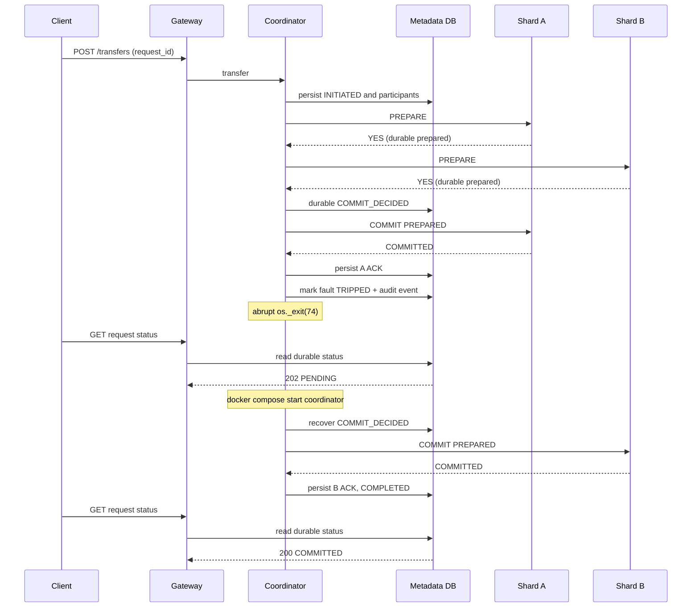

# Stage 07 — Crash recovery and fault injection (2PC)

This stage implements an intentionally abrupt Coordinator process exit at an exact,
durable point in phase 2. It is **local/demo-only and disabled by default**.
It is not a replacement for adversarial migration and self-healing experiments
in later stages.

## Exact crash point

1. Client requests cross-shard transfer A0500 -> A1500, amount **1.00** and unique `request_id`.
2. Coordinator records `INITIATED` + participant routing metadata.
3. Shard A and Shard B each run PostgreSQL `PREPARE TRANSACTION` and vote `YES`.
4. Coordinator durably logs `COMMIT_DECIDED` before sending any phase-2 message.
5. Shard A runs `COMMIT PREPARED` and exposes a durable commit ledger row.
6. Coordinator stores A's ACK in metadata.
7. A pre-armed one-shot fault row is **atomically marked TRIPPED** and a durable
   recovery-event row is written; then `os._exit(74)` kills the Coordinator
   without waiting for shutdown hooks.
8. Shard B remains `PREPARED` and its new balance remains invisible.
9. Gateway continues serving GET `/transactions/{tx_id}` and
   `/transfers/requests/{request_id}` **directly from metadata**, returning
   `202 PENDING` even while Coordinator is offline.
10. Upon `docker compose start coordinator`, its recovery worker runs immediately,
    reads the logged COMMIT decision, calls B's idempotent `COMMIT PREPARED`,
    persists the last ACK and marks the transaction `COMPLETED`.



## Windows / PowerShell runbook

**Preconditions**: Stage 06 tests passed, no running writer against A0500/A1500,
both shard DBs accessible, Stage 07 migration applied. Retain the existing
`.git`, `.env`, and Docker named volumes. **Do not use `down -v`**.

```powershell
# In the folder containing compose.yaml:
docker compose config --quiet
docker compose up --build -d
docker compose run --rm schema-migrator python -m pytest -q tests
# Do this on a disposable local test environment only:
$env:STAGE07_ENABLE_FAULTS = "1"
docker compose up -d --no-deps --force-recreate coordinator
$rid = "stage07-crash-" + ([guid]::NewGuid().ToString("N"))
docker compose run --rm schema-migrator python -m scripts.verify_stage07 --scenario=arm --request-id $rid
# Save $rid somewhere before making the transfer.
$body = @{from_account="A0500";to_account="A1500";amount="1.00";request_id=$rid} | ConvertTo-Json
try {
    Invoke-RestMethod -Uri "http://localhost:8000/transfers" -Method Post -ContentType "application/json" -Body $body
} catch { Write-Host "Coordinator response interrupted (expected during crash): $($_.Exception.Message)" }
# Prove crash status BEFORE restarting Coordinator:
docker compose ps coordinator
docker compose run --rm schema-migrator python -m scripts.verify_stage07 --scenario=crashed --request-id $rid
# Now recover the SAME Coordinator state:
docker compose start coordinator
docker compose run --rm schema-migrator python -m scripts.verify_stage07 --scenario=recovered --request-id $rid
# Optionally restore original balances with a NEW reverse 2PC transfer:
docker compose run --rm schema-migrator python -m scripts.verify_stage07 --scenario=cleanup --request-id $rid
# Disable deliberate faults after the experiment:
$env:STAGE07_ENABLE_FAULTS = "0"
docker compose up -d --no-deps --force-recreate coordinator
Remove-Item Env:\STAGE07_ENABLE_FAULTS
```

The test *must* show `COMMIT_DECIDED`, A ACK true, B ACK false, A committed
ledger once, B's prepared GID present, and Gateway 202 PENDING before restart.
After restart it must show two ACKs, two committed ledgers, no prepared GIDs,
correct balances and harmless repeat of the original request ID.

### Failure-handling cautions

- Expected initial POST response is an HTTP error/unknown outcome; **never retry
  with a different request ID** because the payment may already be underway.
- If `--scenario=crashed` fails, **do not assume the payment was rolled back**;
  inspect transaction metadata and `pg_prepared_xacts` first. Restart the
  Coordinator to let its recovery worker reconcile unresolved work.
- Keep this demo mode off outside an isolated development environment.
- Do not run these checks with concurrent writers against the tested accounts.
- An absent ledger entry alone does not prove ABORT; an in-flight PREPARE may be
  unknown. The coordinator never converts a durable COMMIT into ABORT.
- This still leaves future work on the Bonus I migration/2PC handoff and Bonus II
  autonomous replica replacement.

## Decision immutability and recovery notes

The Stage 02 database trigger refuses any attempt to change an already durable
COMMIT into ABORT. Prepared transactions and the participant commit ledger
survive application replica and Coordinator restarts. The Coordinator holds a
session advisory lock per transaction, so concurrent retry and recovery worker
cannot both drive phase 2 for the same transaction.

The gateway status read is a consistent transaction-level snapshot of metadata.
It reports COMMITTED only after both acknowledgements are persisted; it reports
PENDING when COMMIT is decided but any participant is unacknowledged.

Recovery is **blocking 2PC**, not a fault-tolerant consensus protocol: an
unavailable shard can keep a transaction pending and lock affected rows. No
automatic database failover is required by this assignment.
